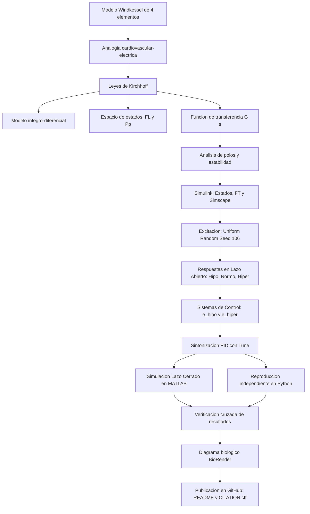

[](https://matlab.mathworks.com/open/github/v1?repo=DrPaulValle/MSFBP0)

# Práctica 2 — Modelado y control del sistema cardiovascular 

Repositorio académico de la asignatura **Modelado de Sistemas Fisiológicos**, correspondiente al programa de **Ingeniería Biomédica** del Tecnológico Nacional de México / Instituto Tecnológico de Tijuana. Esta práctica integra modelado matemático hemodinámico, analogías eléctricas, análisis temporal y de estabilidad, diseño y sintonización de controladores PID en lazo cerrado, simulación computacional *in silico* y verificación cruzada multiplataforma.

El caso de estudio representa la **dinámica cardiovascular del lecho arterial** mediante el **modelo Windkessel de cuatro elementos** ($Z, L, R, C$). Se analiza y compara el comportamiento de un individuo **normotenso** (utilizado como control/referencia) frente a dos condiciones patológicas simuladas: **hipotenso** e **hipertenso**. Posteriormente, se diseñan estrategias de control *in silico* mediante controladores PID para reducir la diferencia de presión entre los casos y la respuesta de referencia.

**Docente:** Dr. Paul Antonio Valle Trujillo  
**Correo:** paul.valle@tectijuana.edu.mx  
**Departamento:** Ingeniería Eléctrica y Electrónica  
**Institución:** Tecnológico Nacional de México / Instituto Tecnológico de Tijuana  
**Asignatura:** Modelado de Sistemas Fisiológicos  
**Programa:** Ingeniería Biomédica  
**Estudiante:** Nicole Vazquez Alvear · C20210923 · LC20210923@tijuana.tecnm.mx

**Repositorio de la asignatura:** https://github.com/nicole-vqz/MSFBP2
**Sede:** Blvd. Alberto Limón Padilla s/n, Tijuana, C. P. 22454, B. C., México.

---

<a id="contenido"></a>
## Contenido

1. [Resumen](#resumen)
2. [Competencia y objetivos](#objetivos)
3. [Relación con el temario](#temario)
4. [Modelo físico y analogía eléctrica](#analogia)
5. [Formulación matemática](#modelo)
6. [Análisis temporal, polos y estabilidad](#analisis)
7. [Señal de entrada y condiciones de simulación](#senales)
8. [Implementación en MATLAB, Simulink y Simscape](#matlab)
9. [Control en lazo cerrado y sintonización PID](#pid)
10. [Reproducción en Python](#python)
11. [Verificación cruzada y discusión](#resultados)
12. [Flujo de trabajo](#flujo)
13. [Actividades del estudiante](#actividades)
14. [Estructura del repositorio](#estructura)
15. [Requisitos](#requisitos)
16. [Reproducibilidad y entregables](#reproducibilidad)
17. [Referencias](#referencias)

---

<a id="resumen"></a>
## Resumen

Esta práctica tiene como propósito **modelar, analizar y controlar la dinámica hemodinámica del sistema cardiovascular** empleando el modelo Windkessel de cuatro elementos ($Z, L, R, C$). Mediante analogías eléctricas, el flujo sanguíneo se representa como corriente y la presión arterial como voltaje. A pesar de contar con cuatro componentes, el sistema posee únicamente dos elementos independientes de almacenamiento de energía (la capacitancia $C$ y la inductancia $L$), constituyendo un sistema de segundo orden.

Se estudian tres estados fisiológicos definidos a partir de variaciones en la distensibilidad arterial ($C$): **normotenso** ($C = 1.500$), **hipotenso** ($C = 3.500$) e **hipertenso** ($C = 1.000$). Se deducen analíticamente las funciones de transferencia $G(s)$, el espacio de estados y la ecuación integro-diferencial de la presión arterial sobre la distensibilidad $P_p(t)$. Se evalúa la estabilidad determinando los polos del sistema en el plano complejo y se comprueba el error en estado estacionario.

Ante una señal de excitación aleatoria continua (`Uniform Random Number`), se comparan las respuestas hemodinámicas en lazo abierto y se implementan esquemas de control PID retroalimentados para forzar a los modelos patológicos a seguir la respuesta fisiológica de la condición normotensa. La validación se realiza mediante simulación cruzada en MATLAB/Simulink, Simscape Electrical y Python.

**Palabras clave:** Modelo Windkessel; sistema cardiovascular; hemodinámica; distensibilidad arterial; controlador PID; espacio de estados; MATLAB; Simulink; Simscape Electrical; Python; simulación *in silico*.

[Volver al contenido](#contenido)

---

<a id="objetivos"></a>
## Competencia y objetivos

### Competencia a desarrollar

Modelizar sistemas fisiológicos mediante circuitos eléctricos equivalentes, ecuaciones diferenciales y funciones de transferencia para analizar su comportamiento dinámico, así como diseñar estrategias de control mediante técnicas de control clásico para igualar respuestas de casos patológicos con respuestas de referencia.

### Objetivo general

Formular el modelo matemático del sistema cardiovascular basado en el circuito Windkessel de cuatro elementos, analizar su respuesta temporal y estabilidad ante variaciones en la distensibilidad arterial, y diseñar controladores PID retroalimentados *in silico* para corregir el comportamiento dinámico de casos hipotensos e hipertensos respecto a la respuesta normotensa de referencia.

### Objetivos específicos

- Identificar la correspondencia entre variables hemodinámicas (presión y flujo) y eléctricas (voltaje y corriente).
- Formular las ecuaciones integro-diferenciales, la representación en espacio de estados y la función de transferencia $G(s) = P_p(s)/P_a(s)$.
- Calcular analíticamente los polos y verificar la estabilidad de las condiciones normotensa, hipotensa e hipertenso.
- Determinar el error en estado estacionario ante entradas de prueba.
- Construir e implementar el modelo en MATLAB/Simulink mediante ecuaciones de estado, funciones de transferencia y Simscape Electrical.
- Implementar dos lazos de control independientes (normotenso-hipotenso y normotenso-hipertenso) y sintonizar las ganancias PID ($k_P, k_I, k_D$) mediante la herramienta `Tune`.
- Reproducir las simulaciones en lazo abierto y lazo cerrado mediante Python en Visual Studio Code.
- Elaborar un diagrama biológico (vía BioRender) relacionando las estructuras vasculares con los elementos $Z, L, R, C$.

[Volver al contenido](#contenido)

---

<a id="temario"></a>
## Relación con el temario

Esta práctica integra contenidos de tres unidades clave de la asignatura **Modelado de Sistemas Fisiológicos (IBF-1020)**:

| Unidad | Área | Contenidos aplicados |
|---|---|---|
| I | Sistemas de control retroalimentados | Diagramas de bloques, señal de error $e(t)$, respuesta dinámica y criterios de estabilidad |
| II | Modelado matemático | Analogía cardiovascular-eléctrica, leyes de Kirchhoff, espacio de estados y función de transferencia Windkessel |
| III | Controladores | Controladores PID, sintonización de ganancias y seguimiento de referencias fisiológicas |

[Volver al contenido](#contenido)

---

<a id="analogia"></a>
## Modelo físico y analogía eléctrica

El sistema arterial proximal y distal se aproxima mediante el circuito **Windkessel de cuatro elementos**.

```
       +--- Z ---+
       |         |
Pa(t) -+--- L ---+-+----- Pp(t)
                   |  |
                   C  R
                   |  |
                  GND GND
```

### Analogía hemodinámica–eléctrica

| Variable / Elemento | Símbolo | Unidades Eléctricas | Propiedad Hemodinámica | Unidades Fisiológicas |
|---|---|---|---|---|
| Presión de entrada | $P_a(t)$ | Voltios ($\mathrm{V}$) | Presión arterial de entrada (Aorta/Pulmonar) | $\mathrm{mmHg}$ |
| Presión distal / Salida | $P_p(t)$ | Voltios ($\mathrm{V}$) | Presión en la distensibilidad arterial | $\mathrm{mmHg}$ |
| Flujo sanguíneo total | $F_a(t)$ | Amperios ($\mathrm{A}$) | Flujo de salida del corazón | $\mathrm{mL/s}$ |
| Impedancia proximal | $Z$ | Resistencia ($\Omega$) | Impedancia característica proximal | $\mathrm{mmHg}\cdot\mathrm{s}\cdot\mathrm{mL}^{-1}$ |
| Inertancia arterial | $L$ | Inductancia ($\mathrm{H}$) | Masa e inercia de la sangre | $\mathrm{mmHg}\cdot\mathrm{s}^2\cdot\mathrm{mL}^{-1}$ |
| Resistencia periférica | $R$ | Resistencia ($\Omega$) | Oposición al flujo en arteriolas/capilares | $\mathrm{mmHg}\cdot\mathrm{s}\cdot\mathrm{mL}^{-1}$ |
| Distensibilidad | $C$ | Capacitancia ($\mathrm{F}$) | Capacidad de almacenamiento vascular | $\mathrm{mL}\cdot(\mathrm{mmHg})^{-1}$ |

### Parámetros hemodinámicos por condición fisiológica

| Parámetro | Hipotenso | Normotenso (Control) | Hipertenso | Unidades |
|---|---:|---:|---:|---|
| $Z$ | $0.010$ | $0.010$ | $0.010$ | $\mathrm{mmHg}\cdot\mathrm{s}\cdot\mathrm{mL}^{-1}$ |
| $L$ | $0.001$ | $0.001$ | $0.001$ | $\mathrm{mmHg}\cdot\mathrm{s}^2\cdot\mathrm{mL}^{-1}$ |
| $R$ | $1.000$ | $1.000$ | $1.000$ | $\mathrm{mmHg}\cdot\mathrm{s}\cdot\mathrm{mL}^{-1}$ |
| $C$ | **$3.500$** | **$1.500$** | **$1.000$** | $\mathrm{mL}\cdot(\mathrm{mmHg})^{-1}$ |

> **Nota fisiológica:** Un incremento en $C$ ($3.500$) ateníua los cambios de presión (hipotensión), mientras que una reducción en $C$ ($1.000$) refleja rigidez arterial y eleva la presión (hipertensión).

[Volver al contenido](#contenido)

---

<a id="modelo"></a>
## Formulación matemática

### 1. Ecuaciones integro-diferenciales

A partir de la conservación del flujo en los nodos ($F_a = F_Z + F_L = F_C + F_R$) y las ecuaciones constitutivas de cada elemento:

$$F_Z(t) = \frac{P_a(t) - P_p(t)}{Z}, \quad F_L(t) = \frac{1}{L}\int [P_a(t) - P_p(t)] \, dt, \quad F_C(t) = C \frac{dP_p(t)}{dt}, \quad F_R(t) = \frac{P_p(t)}{R}$$

Igualando y despejando la variable de salida $P_p(t)$:

$$\boxed{P_p(t) = \left[ \frac{P_a(t)}{Z} + \frac{1}{L}\int [P_a(t) - P_p(t)] \, dt - C\frac{dP_p(t)}{dt} \right] \frac{RZ}{Z+R}}$$

### 2. Representación en Espacio de Estados

Seleccionando como variables de estado $x_1(t) = F_L(t)$ (flujo en la inductancia) y $x_2(t) = P_p(t)$ (presión en el capacitor), con entrada $u(t) = P_a(t)$ y salida $y(t) = P_p(t)$:

$$\begin{bmatrix} \dot{F}_L(t) \\ \dot{P}_p(t) \end{bmatrix} = \begin{bmatrix} 0 & -\frac{1}{L} \\ \frac{1}{C} & -\left(\frac{1}{ZC} + \frac{1}{RC}\right) \end{bmatrix} \begin{bmatrix} F_L(t) \\ P_p(t) \end{bmatrix} + \begin{bmatrix} \frac{1}{L} \\ \frac{1}{ZC} \end{bmatrix} P_a(t)$$

$$y(t) = \begin{bmatrix} 0 & 1 \end{bmatrix} \begin{bmatrix} F_L(t) \\ P_p(t) \end{bmatrix}$$

### 3. Función de transferencia $G(s)$

Aplicando la Transformada de Laplace con condiciones iniciales nulas:

$$\frac{P_a(s) - P_p(s)}{Z} + \frac{P_a(s) - P_p(s)}{Ls} = Cs P_p(s) + \frac{P_p(s)}{R}$$

Agrupando términos y resolviendo algebraicamente:

$$\boxed{G(s) = \frac{P_p(s)}{P_a(s)} = \frac{LRs + RZ}{CLRZ s^2 + L(Z+R)s + RZ}}$$

Sustituyendo el denominador desarrollado de la forma $a s^2 + b s + c$, se obtienen las expresiones numéricas para cada caso:

- **Hipotenso ($C=3.500$):**
  $$G_{\mathrm{hipo}}(s) = \frac{0.001s + 0.01}{3.5\times 10^{-5}s^2 + 0.00101s + 0.01}$$
- **Normotenso ($C=1.500$):**
  $$G_{\mathrm{normo}}(s) = \frac{0.001s + 0.01}{1.5\times 10^{-5}s^2 + 0.00101s + 0.01}$$
- **Hipertenso ($C=1.000$):**
  $$G_{\mathrm{hiper}}(s) = \frac{0.001s + 0.01}{1.0\times 10^{-5}s^2 + 0.00101s + 0.01}$$

[Volver al contenido](#contenido)

---

<a id="analisis"></a>
## Análisis temporal, polos y estabilidad

### 1. Error en estado estacionario ($e_{ss}$)

Aplicando el Teorema del Valor Final para una entrada escalón unitario $P_a(s) = 1/s$:

$$e_{ss} = \lim_{s \to 0} s P_a(s) \left[1 - G(s)\right] = 1 - G(0) = 1 - \frac{RZ}{RZ} = 0$$

$$\boxed{e_{ss} = 0}$$

El error nulo en estado estacionario se verifica analíticamente para los tres modelos en lazo abierto ante entradas constantes.

### 2. Polos del sistema y estabilidad

Los polos $\lambda_{1,2}$ corresponden a las raíces de la ecuación característica $CLRZ s^2 + L(Z+R)s + RZ = 0$:

$$\lambda_{1,2} = \frac{-L(Z+R) \pm \sqrt{L^2(Z+R)^2 - 4 C L R^2 Z^2}}{2 C L R Z}$$

Sustituyendo los parámetros numéricos de cada condición fisiológica:

| Caso | Polos ($\lambda_1, \lambda_2$) | Naturaleza del sistema | Estabilidad |
|---|---|---|---|
| **Hipotenso** ($C=3.5$) | $\lambda_{1,2} = -14.429 \pm 8.8051i$ | Subamortiguado (par complejo conjugado) | **Estable** (Re $< 0$) |
| **Normotenso** ($C=1.5$) | $\lambda_1 = -12.062, \quad \lambda_2 = -55.272$ | Sobreamortiguado (raíces reales distintas) | **Estable** (Re $< 0$) |
| **Hipertenso** ($C=1.0$) | $\lambda_1 = -10, \quad \lambda_2 = -10$ | Críticamente amortiguado (raíz real doble) | **Estable** (Re $< 0$) |

**Conclusión de estabilidad:** Los tres modelos son asintóticamente estables. Sin embargo, el caso hipotenso presenta oscilaciones transitorias debido a sus polos complejos conjugados, mientras que el hipertenso responde con la máxima rapidez sin sobreimpulso propio antes del régimen permanente.

[Volver al contenido](#contenido)

---

<a id="senales"></a>
## Señal de entrada y condiciones de simulación

Para evaluar la dinámica cardiovascular bajo variaciones aleatorias continuas, la simulación utiliza la siguiente configuración:

- **Bloque:** `Uniform Random Number` de Simulink.
- **Límites de amplitud:** $min = -0.2$, $max = 1.0$.
- **Semilla (`seed`):** $106$.
- **Tiempo de muestreo ($T_s$):** $0.1\,\mathrm{s}$.
- **Tiempo de simulación:** $t \in [0, 15]\,\mathrm{s}$.

> **Garantía de reproducibilidad:** Se emplea exactamente la misma semilla ($106$) y señal de excitación para los tres modelos, asegurando que las diferencias en las respuestas $P_p(t)$ provengan únicamente de las propiedades vasculares del paciente.

[Volver al contenido](#contenido)

---

<a id="matlab"></a>
## Implementación en MATLAB, Simulink y Simscape

Se construyen e integran tres representaciones computacionales equivalentes:

1. **Espacio de Estados (Simulink):** Mediante el bloque `State-Space` cargando las matrices $A, B, C, D$.
2. **Función de Transferencia (Simulink):** Mediante bloques `Transfer Fcn` ajustando el numerador $[LR, RZ]$ y denominador $[CLRZ, L(Z+R), RZ]$.
3. **Circuito equivalente (Simscape Electrical):** Ensamblado físico-eléctrico de los componentes $Z, L, R, C$ e instrumentos de medición de voltaje y corriente.

El cuaderno computacional `.mlx` ejecuta automáticamente el modelo `.slx`, recupera los vectores del *Workspace* y genera las figuras comparativas.

[Volver al contenido](#contenido)

---

<a id="pid"></a>
## Control en lazo cerrado y sintonización PID

### Esquema de control de tratamiento

Se utilizan dos esquemas independientes donde la respuesta normotensa $P_{p,\mathrm{normo}}(t)$ actúa como la **referencia ideal**:

1. **Lazo Normotenso-Hipotenso:** $e_{\mathrm{hipo}}(t) = P_{p,\mathrm{normo}}(t) - P_{p,\mathrm{hipo}}(t)$.
2. **Lazo Normotenso-Hipertenso:** $e_{\mathrm{hiper}}(t) = P_{p,\mathrm{normo}}(t) - P_{p,\mathrm{hiper}}(t)$.

```
                 +-------------------+
                 |  Individuo sano   |---> Pp,normo(t) [Referencia]
           +---->|    (Normotenso)   |--------+
           |     +-------------------+        |
Ve(t) -----+                                  | +  -
 (Random)  |     +-------------------+        ( Σ )---> [ PID ] ---> [ Paciente ] ---> Pp,tratado(t)
           +---->|     Paciente      |        ^                      (Caso Hipo/Hiper)
                 |    (Caso Hipo/Hiper)       |
                 +-------------------+        +--- Pp,caso(t) (Lazo Abierto)
```

### Sintonización mediante Tune

Utilizando el sintonizador automático `Tune` de Simulink, se determinan las ganancias para minimizar la señal de error y lograr un seguimiento rápido de la respuesta saludable:

| Controlador | $k_P$ | $k_I$ | $k_D$ | Desempeño |
|---|---:|---:|---:|---|
| **PID Hipotenso** | *Ajustar en simulación* | *Ajustar en simulación* | *Ajustar en simulación* | Reducción de oscilaciones transitorias |
| **PID Hipertenso** | *Ajustar en simulación* | *Ajustar en simulación* | *Ajustar en simulación* | Incremento en la rapidez de respuesta |

*(Sustituir los valores numéricos obtenidos en su sesión de sintonización).*

[Volver al contenido](#contenido)

---

<a id="python"></a>
## Reproducción en Python

Mediante la librería `scipy.signal` y `matplotlib` en **Visual Studio Code**, se realiza la validación independiente:

1. Replicación exacta del vector aleatorio de entrada $P_a(t)$ con semilla $106$.
2. Definición de las funciones de transferencia $G_{\mathrm{hipo}}(s), G_{\mathrm{normo}}(s), G_{\mathrm{hiper}}(s)$.
3. Construcción del sistema retroalimentado $T(s) = \frac{K(s)G(s)}{1 + K(s)G(s)}$ utilizando las ganancias sintonizadas.
4. Simulación de la respuesta forzada mediante `scipy.signal.lsim`.
5. Exportación de gráficas comparativas en formato PDF.

[Volver al contenido](#contenido)

---

<a id="resultados"></a>
## Verificación cruzada y discusión

### Cuadro comparativo de representaciones

Se constata la equivalencia numérica entre:
- Ecuaciones de Espacio de Estados en Simulink.
- Funciones de Transferencia en Simulink.
- Simulación física en Simscape Electrical.
- Cuaderno computacional de MATLAB `.mlx`.
- Script de Python.

### Archivos de resultados y evidencias

| Entregable / Figura | Descripción / Ruta de archivo |
|---|---|
| **Diagrama Biológico** | Diagrama de estructuras vasculares y equivalencia con $Z, L, R, C$. |
| **Respuesta Lazo Abierto** | Comparativa $P_{p,\mathrm{normo}}(t)$, $P_{p,\mathrm{hipo}}(t)$, $P_{p,\mathrm{hiper}}(t)$. |
| **Lazo Cerrado Hipotenso** | Comparativa Normotenso vs Hipotenso vs Hipotenso+PID. |
| **Lazo Cerrado Hipertenso** | Comparativa Normotenso vs Hipertenso vs Hipertenso+PID. |

[Volver al contenido](#contenido)

---

<a id="flujo"></a>
## Flujo de trabajo



[Volver al contenido](#contenido)

---

<a id="actividades"></a>
## Actividades del estudiante

### Etapa 1. Formulación y análisis analítico

- [x] Identificar parámetros hemodinámicos y equivalencias del circuito.
- [x] Derivar la ecuación integro-diferencial del modelo Windkessel.
- [x] Obtener las ecuaciones en Espacio de Estados.
- [x] Calcular la Función de Transferencia $G(s)$.
- [x] Determinar analíticamente los polos y estabilidad para el caso normotenso, hipotenso e hipertenso.
- [x] Verificar que el error en estado estacionario es $e_{ss} = 0$.

### Etapa 2. Simulación computacional

- [x] Implementar espacio de estados, $G(s)$ y Simscape en Simulink.
- [x] Configurar la señal `Uniform Random Number` con `seed = 106`.
- [x] Obtener y comparar las respuestas de lazo abierto.

### Etapa 3. Control y verificación

- [x] Diseñar los esquemas de retroalimentación normotenso-hipotenso y normotenso-hipertenso.
- [x] Sintonizar las ganancias PID mediante `Tune`.
- [x] Simular el tratamiento en lazo cerrado.
- [x] Reproducir todo el flujo en Python (VS Code).
- [x] Diseñar el diagrama biológico del sistema cardiovascular.
- [x] Elaborar el reporte en `README.md` y publicar el archivo `CITATION.cff`.

[Volver al contenido](#contenido)

---

<a id="estructura"></a>
## Estructura del repositorio

```text
.
├── README.md                      # Reporte principal de la Práctica 2
├── CITATION.cff                   # Datos de citación del repositorio
├── Apellido_NoControl_P2.mlx      # Cuaderno MATLAB de automatización
├── Apellido_NoControl_P2.pdf      # Exportación del cuaderno MATLAB
├── windkessel_model.slx           # Modelo Simulink (Estados, FT, Simscape, PID)
├── windkessel_python.py           # Código de reproducción en Python
├── diagrama_biologico.png        # Diagrama cardiovascular (BioRender)
├── sintonizacion_pid_hipo.png     # Evidencia Tune caso hipotenso
├── sintonizacion_pid_hiper.png    # Evidencia Tune caso hipertenso
├── lazo_abierto.pdf              # Comparativa de lazo abierto
├── lazo_cerrado_hipo.pdf          # Respuesta controlada caso hipotenso
├── lazo_cerrado_hiper.pdf         # Respuesta controlada caso hipertenso
└── evidencias/                    # Capturas adicionales y datos auxiliares
```

[Volver al contenido](#contenido)

---

<a id="requisitos"></a>
## Requisitos

### Software

- **MATLAB y Simulink** (con Control System Toolbox y Simscape Electrical).
- **Python 3.x** (con `numpy`, `scipy`, `matplotlib`) y **Visual Studio Code**.
- **BioRender** (o software afín) para la representación del diagrama cardiovascular.
- **Git y GitHub**.

[Volver al contenido](#contenido)

---

<a id="reproducibilidad"></a>
## Reproducibilidad y entregables

1. Clonar el repositorio.
2. Abrir `Apellido_NoControl_P2.mlx` en MATLAB y ejecutar todas las secciones para compilar el modelo de Simulink `windkessel_model.slx` y generar los reportes PDF.
3. Ejecutar `windkessel_python.py` en VS Code para verificar la coincidencia de curvas entre plataformas.
4. Consultar las figuras generadas en la raíz del proyecto.

[Volver al contenido](#contenido)

---

<a id="referencias"></a>
## Referencias

[1] M. C. Khoo, *Physiological Control Systems: Analysis, Simulation, and Estimation*, 2nd ed., IEEE Press, 2018.

[2] F. C. Hoppensteadt y C. S. Peskin, *Modeling and Simulation in Medicine and the Life Sciences*, Springer.

[3] J. E. Hall, *Guyton and Hall Textbook of Medical Physiology*, 14th ed., Elsevier, 2021.

[4] K. Ogata, *Ingeniería de Control Moderna*, 5.ª ed., Pearson Educación, 2010.

[5] N. S. Nise, *Control Systems Engineering*, 8th ed., John Wiley & Sons, 2020.

[6] P. A. Valle, *Syllabus para Modelado de Sistemas Fisiológicos*, Tecnológico Nacional de México / Instituto Tecnológico de Tijuana, Tijuana, B. C., México, 2026. Disponible en: https://biomath.xyz/course/

[7] Tecnológico Nacional de México, *Programa de estudio de la asignatura Modelado de Sistemas Fisiológicos, IBF-1020*.

---

## Uso académico

Este repositorio constituye la evidencia del desarrollo de la **Práctica 2** de la asignatura **Modelado de Sistemas Fisiológicos**. Las estrategias de control desarrolladas tienen propósitos estrictamente académicos y de simulación *in silico*, y no constituyen recomendaciones ni protocolos clínicos terapéuticos reales.